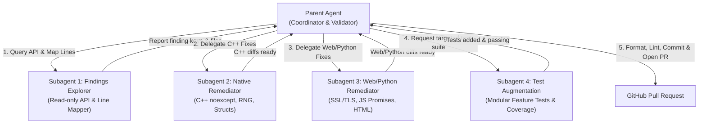

# SonarQube Cloud Quality & Security Remediation Guide

This skill provides an authoritative, reusable playbook for identifying, triaging, and remediating code quality issues, security vulnerabilities, reliability bugs, maintainability smells, security hotspots, and code duplication detected by SonarQube Cloud (SonarCloud) across all `carlkidcrypto` repositories (`ezsnmp`, `ezsnmp_data_logger`, `purpleair_api`, `purpleair_data_logger`, `purpleair-matterbridge`, `os-specific-runner`, etc.).

---

## ⚠️ Critical Rule: Maintainer Merge & Release Boundaries

> [!CAUTION]
> **NEVER merge pull requests, create git release tags, or trigger automated package publishing.**
> - Merging pull requests into `main` or release branches (`gh pr merge`) is strictly reserved for the **maintainer (the user, @carlkidcrypto)**.
> - Publishing GitHub releases (`gh release create`), creating git tags (`vYYYY.M.D`), or dispatching release deployment workflows (PyPI, npm, NuGet) must never be executed by the agent.
> - The agent prepares branches, addresses findings, verifies local test suites and linters, opens pull requests, monitors CI check runs, and presents status reports and PR links to the maintainer.
> - Stop immediately and hand off to the maintainer once the pull request is submitted and CI checks pass.

---

## Multi-Agent Concurrency & Git Worktree Isolation

> [!IMPORTANT]
> **Always isolate SonarCloud remediation work using dedicated Git Worktrees.**
> Multiple agents (the human maintainer, background synchronization agents, Dependabot, Copilot, and other agentic workflows) operate concurrently across local repositories. Switching branches or leaving dirty uncommitted files in the primary repository checkout root (`<workspace_root>/<repo>`) causes branch collisions, overwritten working trees, stash conflicts, and broken builds.
>
> **Mandatory Worktree Lifecycle**:
> 1. **Active Worktree Discovery**: Always execute `git worktree list` first to inspect existing worktrees, their directory paths, and their checked-out branches before performing any branch or worktree operations, avoiding branch collisions (`fatal: '<branch>' is already used by worktree at ...`).
> 2. **Primary Checkout Root Immutability**: The primary checkout root `<workspace_root>/<repo>` must remain permanently clean and on the default branch (`main`). Never checkout task branches or leave unstaged/staged dirty files in the primary repository root.
> 3. **Spawn Dedicated Worktree in Sibling Directory**: Always create dedicated worktrees in sibling directories (e.g. `<workspace_root>/<repo>-<task-name>` or `<workspace_root>/wt-<repo>-<task-name>`). Never create worktrees in `/tmp` or `~/.gemini/` unless explicitly instructed.
>    ```bash
>    # 1. Fetch latest remote references
>    git fetch origin
>
>    # 2. Check existing active worktrees
>    git worktree list
>
>    # 3. Create a dedicated worktree for the remediation branch from origin/main
>    git worktree add -b fix/sonar-security-remediation <workspace_root>/wt-<repo>-sonar-remediation origin/main
>    cd <workspace_root>/wt-<repo>-sonar-remediation
>    ```
> 4. **Strict Execution Isolation**: Execute all dependency installations, compilation (`setup.py build_ext`, `cmake`, `meson`), test suites (`pytest`, `ctest`), linters and formatters (`black`, `prettier`, `csharpier`, `clang-format`), targeted staging (`git add <files>`), and PR creation (`gh pr create`) strictly inside the isolated worktree directory.
> 5. **Handling Remote Syncs (`sync_open_prs_with_main`)**: Sibling background workflows regularly merge `main` into open PR branches. If a `git push` is rejected due to remote updates, execute `git pull --rebase origin <branch-name>` inside the worktree before pushing again.
> 6. **Handling Maintainer-Merged PR Follow-ups**: If an open PR has already been merged into `main` by the maintainer while follow-up commits are being prepared, do not force-push over merged commits. Fetch `origin`, branch cleanly from `origin/main` (`git checkout -b <fix-branch> origin/main`), cherry-pick the required commit (`git cherry-pick <sha>`), and submit a new PR cleanly.
> 7. **Clean Pruning**: Never modify, overwrite, or delete another agent's active worktree. Once your PR is submitted or merged, cleanly remove and prune the worktree:
>    ```bash
>    git worktree remove <workspace_root>/wt-<repo>-sonar-remediation
>    git worktree prune
>    ```
>    Verify `git worktree list` confirms the worktree was cleanly detached without dangling metadata.

---

## SonarCloud Quality Gate Criteria & Ecosystem Targets

To achieve and maintain a passing Quality Gate and an **A** grade across all metrics for `carlkidcrypto` repositories, every pull request and main branch must satisfy:

| Metric Pillar | Target Grade / Value | Description |
| :--- | :--- | :--- |
| **Security Rating** | **A** (`1.0`) | **0 open vulnerabilities**. Any vulnerability automatically drops the rating to B, C, D, or E. |
| **Reliability Rating** | **A** (`1.0`) | **0 open bugs**. No unresolved functional, concurrency, or resource leak bugs. |
| **Maintainability Rating** | **A** (`1.0`) | Technical debt ratio < 5.0%. Clean, idiomatic code without high-severity smells. |
| **Security Hotspots** | **100.0%** Reviewed | All security-sensitive code paths must be reviewed and marked safe or remediated. |
| **Duplicated Lines Density** | **0.0%** | Duplication density must remain 0.0% on new code (Quality Gate limit: < 3.0%). |
| **Codecov Patch Coverage** | **>= 100.0%** | All newly added or modified lines must have complete automated unit test coverage. |
| **Codecov Project Coverage** | **No Regression** | Overall repository test coverage percentage must not drop. |

> [!NOTE]
> SonarCloud numerical ratings map as follows:
> - `1.0` = **A**
> - `2.0` = **B**
> - `3.0` = **C**
> - `4.0` = **D**
> - `5.0` = **E**
>
> If a project reports a `security_rating` or `reliability_rating` of `4.0`, it has received a **D** rating due to critical or major vulnerabilities/bugs.

---

## Live SonarCloud REST API Discovery & Inspection

Always inspect live SonarCloud API findings to obtain the exact list of issues, affected file paths, line numbers, and rule identifiers before writing fixes. Public repositories do not require authentication, but token authentication via `SONAR_TOKEN` can be supplied if configured.

### 1. Project Quality Gate Status
Check whether the Quality Gate is passing (`OK`) or failing (`ERROR`) on `main` or on an open PR:

```bash
# Check branch=main:
curl -s "https://sonarcloud.io/api/qualitygates/project_status?projectKey=carlkidcrypto_<repo>&branch=main" | jq .

# Check pullRequest=N:
curl -s "https://sonarcloud.io/api/qualitygates/project_status?projectKey=carlkidcrypto_<repo>&pullRequest=<PR_NUMBER>" | jq .
```

### 2. High-Level Metrics & Letter Grades
Inspect overall ratings for Security, Reliability, Maintainability, Duplication, and Hotspots:

```bash
curl -s "https://sonarcloud.io/api/measures/component?component=carlkidcrypto_<repo>&metricKeys=security_rating,reliability_rating,sqale_rating,duplicated_lines_density,security_hotspots_reviewed,coverage,bugs,vulnerabilities,code_smells" \
  | jq '.component.measures[] | {metric: .metric, value: .value}'
```

### 3. Querying Active Vulnerabilities & Bugs
Search for unresolved issues filtered by type (`VULNERABILITY`, `BUG`, `CODE_SMELL`):

```bash
# List all active vulnerabilities with file paths and line numbers:
curl -s "https://sonarcloud.io/api/issues/search?componentKeys=carlkidcrypto_<repo>&branch=main&resolved=false&types=VULNERABILITY" \
  | jq '{total: .total, issues: [.issues[] | {key: .key, rule: .rule, severity: .severity, component: .component, line: .line, message: .message}]}'

# List all active reliability bugs:
curl -s "https://sonarcloud.io/api/issues/search?componentKeys=carlkidcrypto_<repo>&branch=main&resolved=false&types=BUG" \
  | jq '{total: .total, issues: [.issues[] | {key: .key, rule: .rule, severity: .severity, component: .component, line: .line, message: .message}]}'

# Search issues for a specific Pull Request:
curl -s "https://sonarcloud.io/api/issues/search?componentKeys=carlkidcrypto_<repo>&pullRequest=<PR_NUMBER>&resolved=false" \
  | jq '{total: .total, issues: [.issues[] | {key: .key, rule: .rule, severity: .severity, component: .component, line: .line, message: .message}]}'
```

### 4. Querying Security Hotspots to Review
Inspect open security hotspots requiring review:

```bash
curl -s "https://sonarcloud.io/api/hotspots/search?projectKey=carlkidcrypto_<repo>&branch=main&status=TO_REVIEW" \
  | jq '{total: .paging.total, hotspots: [.hotspots[] | {key: .key, ruleKey: .ruleKey, component: .component, line: .line, message: .message}]}'
```

---

## Systematic Remediation Playbook

### 1. Security Vulnerabilities & Hotspots

#### A. Hardcoded Credentials & Sensitive Passwords (`cpp:S6418`, `cpp:S2068`, `python:S2068`)
- **Root Cause**: SonarQube flags variable names, constants, or defaults containing tokens like `password = "secret"`, `snmp_auth_passphrase = "password"`, or test credentials hardcoded directly into production headers, sources, or config parsers.
- **Remediation Pattern**:
  - Never assign non-empty literal default strings to credential fields (e.g. `auth_passphrase`, `priv_passphrase`, `api_key`, `secret_key`).
  - Initialize sensitive fields to empty strings (`""`) or `std::nullopt` / `None`, requiring users to supply credentials via configuration files, secure key stores, or environment variables.
  - If a fallback string is required for documentation or testing, load it conditionally from an environment variable (e.g., `std::getenv("TEST_AUTH_KEY")` or `os.getenv("TEST_AUTH_KEY")`) rather than hardcoding.
  ```cpp
  // ❌ VULNERABLE (cpp:S2068 / cpp:S6418)
  std::string auth_password = "default_password_123";

  // ✅ REMEDIATED
  std::string auth_password = "";
  if (const char* env_p = std::getenv("EZSNMP_AUTH_PASSWORD")) {
      auth_password = env_p;
  }
  ```

#### B. Weak Pseudorandom Number Generators (`cpp:S2245`, `python:S311`)
- **Root Cause**: Use of standard PRNGs (`rand()`, `std::rand()`, `std::mt19937`, `random.random()`, `random.randint()`) in security-sensitive contexts (tokens, identifiers, nonces, cryptography).
- **Remediation Pattern**:
  - **C++**: Use cryptographically secure OS entropy sources (`std::random_device`, OpenSSL `RAND_bytes`, `arc4random_buf` on BSD/macOS, or `BCryptGenRandom` on Windows) when generating tokens, transaction IDs, or nonces.
  ```cpp
  // ❌ VULNERABLE (cpp:S2245: rand() is not cryptographically secure)
  int token = std::rand();

  // ✅ REMEDIATED
  std::random_device rd;
  std::uniform_int_distribution<uint32_t> dist(100000, 999999);
  uint32_t token = dist(rd);
  ```
  - **Python**: Replace `random.random()`, `random.choice()`, or `random.randint()` with the standard `secrets` library or `os.urandom`.
  ```python
  # ❌ VULNERABLE (python:S311)
  import random

  token = "".join(random.choices(string.ascii_letters, k=32))

  # ✅ REMEDIATED
  import secrets

  token = secrets.token_hex(16)
  ```

#### C. Insecure SSL/TLS Configuration (`python:S5527`, `python:S4830`)
- **Root Cause**: Disabling SSL certificate validation (`verify=False`, `ssl.CERT_NONE`, or omitting hostname checks) in helper tools, test harnesses, or package scripts (e.g., WinGet manifest generators, HTTP clients).
- **Remediation Pattern**:
  - Always enforce `ssl.CERT_REQUIRED` and `check_hostname=True` when constructing SSL contexts in Python:
  ```python
  # ❌ VULNERABLE (python:S5527, python:S4830)
  ctx = ssl.create_default_context()
  ctx.check_hostname = False
  ctx.verify_mode = ssl.CERT_NONE

  # ✅ REMEDIATED
  ctx = ssl.create_default_context()
  ctx.check_hostname = True
  ctx.verify_mode = ssl.CERT_REQUIRED
  ```

#### D. Insecure Transport / HTTP Protocol (`python:S5332`, `cpp:S5332`)
- **Root Cause**: Explicit hardcoding of `http://` URLs instead of `https://`.
- **Remediation Pattern**:
  - Update all endpoint URLs, documentation URLs, and schema references to `https://`.
  - For local development servers or loopback binds (`localhost` / `127.0.0.1`), make the protocol configurable via flags or options, defaulting production endpoints to HTTPS.

#### E. Subprocess Command Injection (`python:S6002`, `python:S6003`, `python:S6007`)
- **Root Cause**: Invoking subprocesses with `shell=True` or passing unescaped shell strings.
- **Remediation Pattern**:
  - Always pass commands as argument lists (`shell=False`, which is the default in Python `subprocess.run(["cmd", "arg1", "arg2"])`).
  - Avoid shell expansions, command chaining (`&&`, `||`, `;`), and string interpolation.

---

### 2. C++ Destructor & Exception Safety (`cpp:S1048`)

> [!IMPORTANT]
> **Avoid Dead Catch Blocks that Hurt Codecov Patch Coverage.**
> SonarCloud flags destructors that may throw uncaught exceptions (`cpp:S1048`: *"Do not throw uncaught exceptions in a destructor"*).
> **The Anti-Pattern**: Wrapping destructor bodies in `try { ... } catch (...) {}` suppresses the warning, but creates unreachable catch blocks during standard testing. Because cleanup routines rarely throw in test environments, these dead catch blocks drop **Codecov patch coverage** below 100%, causing CI coverage checks to fail.

#### Architectural Fix:
1. Mark the destructor `noexcept` explicitly or rely on C++11 default `noexcept` for destructors.
2. Mark the underlying cleanup methods (`close() noexcept`, `stop() noexcept`, `flush() noexcept`) `noexcept`.
3. Handle errors internally inside `close()` or `stop()` using error return codes or internal logging rather than throwing exceptions.
4. Ensure the destructor calls `noexcept` functions directly with zero throwing potential:

```cpp
// ❌ WRONG: Swallowing exceptions with dead catch blocks (kills Codecov coverage)
DataLogger::~DataLogger() {
    try {
        stop(); // If stop() can throw, this catch block is never hit in normal tests
    } catch (...) {
        // Untested code path! Codecov reports missing patch coverage!
    }
}

// ✅ RIGHT: Architecturally noexcept cleanup
class DataLogger {
public:
    ~DataLogger() noexcept {
        stop();
    }

    void stop() noexcept {
        if (!running_.exchange(false)) {
            return;
        }
        // Safe internal cleanup that catches/handles internal errors cleanly:
        try {
            if (worker_thread_.joinable()) {
                worker_thread_.join();
            }
        } catch (const std::system_error& ex) {
            // Log to stderr or error sink if needed without throwing
        }
    }
};
```

---

### 3. JavaScript / Web UI Reliability & Accessibility

#### A. Unhandled Promises (`javascript:S9383`)
- **Root Cause**: Floating asynchronous promises in frontend JavaScript (`app.js`) without awaiting, chaining `.catch()`, or explicitly ignoring with `void`.
- **Remediation Pattern**:
  - Always handle potential rejections with `.catch(handleError)` or await inside an async function:
  ```javascript
  // ❌ VULNERABLE / BUG (javascript:S9383)
  fetchData();

  // ✅ REMEDIATED
  void fetchData().catch((err) => {
    console.error("Failed to fetch data:", err);
  });
  // Or:
  await fetchData();
  ```

#### B. Form Input Accessibility (`Web:InputWithoutLabelCheck`)
- **Root Cause**: HTML `<input>` or `<select>` tags missing an associated `<label>` element.
- **Remediation Pattern**:
  - Associate every input with a matching label using the `for` and `id` attributes:
  ```html
  <!-- ❌ BUG (Web:InputWithoutLabelCheck) -->
  <input type="text" id="filter-input" placeholder="Search..." />

  <!-- ✅ REMEDIATED -->
  <label for="filter-input">Filter Items</label>
  <input type="text" id="filter-input" placeholder="Search..." />
  ```

---

### 4. Duplication Elimination (`sonar.cpd.exclusions` & Refactoring)

SonarCloud enforces strict copy-paste detection (CPD). Repositories in the `carlkidcrypto` ecosystem target **0.0% duplication density**.

#### A. Repository `.sonarcloud.properties` Configuration
Configure root `.sonarcloud.properties` with clear exclusion boundaries:
1. Exclude generated documentation (`docs/**`, `sphinx_docs_build/**`).
2. Exclude workflow definitions (`.github/**`).
3. Exclude third-party or vendored dependencies (`third_party/**`).
4. Exclude generated bindings (`*_wrap.cxx`, `*_wrap.h`, wrapper `.py`, `generated/**`).
5. Configure `sonar.cpd.exclusions` for test suites and configurations where repetitive test fixtures are structurally necessary:
   ```properties
   sonar.projectKey=carlkidcrypto_<repo>
   sonar.organization=carlkidcrypto

   # Exclude non-production and generated code from general analysis
   sonar.exclusions=docs/**,sphinx_docs_build/**,.github/**,third_party/**,**/*_wrap.*,build/**,dist/**

   # Exclude test suites and configs from CPD (duplication detection) to achieve 0.0% duplication
   sonar.cpd.exclusions=**/*_tests/**,tests/**,configs/**,tools/**
   ```

#### B. Structural Code Deduplication (C++ / Python)
- **Shared Structs & Data Models**:
  - Never duplicate struct definitions (e.g. `SnmpRecord`, `MetricsPayload`, `LogEntry`) across multiple `.cpp` or `.hpp` files.
  - Extract shared structures into dedicated common headers under `include/<project>/common/` or `include/<project>/types.hpp`.
- **Repeated Parsing Logic**:
  - Extract repetitive validation, JSON serialization, or string conversions into reusable utility functions.

---

### 5. Codecov Coverage Preservation & Test Suite Augmentation

> [!CAUTION]
> **Anti-"Full Coverage" Naming Policy**:
> Unit and integration tests must **never** be collected into generic catch-all files like `test_full_coverage.*` or `full_coverage.*`.
> Tests must be organized into modular, feature-focused test files named after specific architectural components, interfaces, or capabilities (e.g., `test_sink_inspector.cpp`, `test_cli_and_entrypoints.py`, `test_gui_server.py`, `test_desktop_tk.py`).

1. **Verify Coverage Glob Matching**:
   Ensure `codecov.yml` matches both root and nested files (`*.py` and `**/*.py`, `*.cpp` and `**/*.cpp`):
   ```yaml
   coverage:
     status:
       project:
         default:
           target: auto
           threshold: 1%
       patch:
         default:
           target: 100%
   ```
2. **Augment Tests for Fixed Paths**:
   Whenever a security fix introduces a branch (e.g., validating an HTTPS URL, verifying certificate paths, or handling an empty password), write dedicated unit tests covering:
   - The valid/happy path.
   - The rejection/error path.
   - The default configuration fallback.
3. **Execute Local Test Suites Before Staging**:
   Run the local test harness to guarantee 100% passing tests and complete coverage before committing:
   ```bash
   # Python test execution with coverage:
   pytest python_tests/ --cov=ezsnmp_data_logger --cov-report=term-missing

   # C++ test execution:
   ctest --output-on-failure
   ```

---

## Subagent Orchestration Guidelines

When remediating large repositories with multi-language codebases (e.g., mixed C++, Python, JavaScript, and shell scripts), decompose tasks and orchestrate subagents to accelerate discovery and execution:



### Delegation Roles:
1. **Findings Explorer Subagent**:
   - Queries SonarCloud live API endpoints (`project_status`, `issues/search`, `hotspots/search`).
   - Maps exact rule keys to source code files and line numbers.
   - Summarizes the findings table for the parent agent.
2. **Native / C++ Remediator Subagent**:
   - Updates C++ headers and sources for `noexcept` exception safety (`cpp:S1048`).
   - Fixes PRNG usage (`cpp:S2245`), credential constants (`cpp:S2068`, `cpp:S6418`).
   - Refactors shared structs to eliminate duplication.
3. **Python / JavaScript Remediator Subagent**:
   - Updates SSL contexts (`python:S5527`, `python:S4830`).
   - Replaces `random` with `secrets` (`python:S311`).
   - Handles floating JS promises (`javascript:S9383`) and HTML labels (`Web:InputWithoutLabelCheck`).
4. **Test Augmentation Specialist**:
   - Authors modular unit tests for all changed code paths.
   - Ensures zero dead catch blocks and verifies 100% Codecov patch coverage.

---

## Validation & PR Handoff Checklist

Before handing off the pull request to the maintainer, verify every step in this checklist:

### Pre-Commit Local Validation (Inside Worktree)
- [ ] **Formatting**: Run all ecosystem formatters:
  - Python: `black <modified_files>`
  - JavaScript / JSON: `npx prettier --write <modified_files>`
  - C#: `csharpier <modified_files>`
  - C/C++: `clang-format -i <modified_files>`
- [ ] **Syntax & Linting**:
  - Run `yamllint .github/workflows/` (excluding `*.lock.yml`).
  - Run `flake8` or `ruff` if configured.
- [ ] **Local Tests**:
  - Run unit tests to confirm 100% test pass rate.
  - Confirm Codecov patch coverage >= 100%.
- [ ] **Targeted Staging**:
  - Use `git add <file1> <file2>`. Never execute blanket `git add .` or `git add -A`.

### PR Creation & CI Verification
- [ ] **Commit Message**: Use conventional commit formatting:
  ```bash
  git commit -m "fix(security): resolve SonarCloud security vulnerabilities and quality findings"
  ```
- [ ] **Push & Open PR**:
  ```bash
  git push -u origin fix/sonar-security-remediation
  gh pr create --title "fix(security): resolve SonarCloud security and reliability findings" --body "..."
  ```
- [ ] **Monitor CI Matrix**:
  - Run `gh pr checks` to verify all GitHub Actions workflows pass cleanly.
- [ ] **Verify Live SonarCloud Quality Gate on PR**:
  - Query `/api/qualitygates/project_status?projectKey=carlkidcrypto_<repo>&pullRequest=<PR_NUMBER>` to confirm `status: "OK"` and `new_security_rating: "1"` (Rating A).

### Threaded Review Comment Replies (If Applicable)
- [ ] Reply directly to every automated or maintainer review comment:
  ```bash
  gh api repos/{owner}/{repo}/pulls/{pull_number}/comments -F in_reply_to={comment_id} \
    -f body="Addressed in commit \`<commit_sha>\`: Resolved by marking cleanup methods noexcept and adding unit tests."
  ```

### Final Handoff to Maintainer
- [ ] Provide a concise summary to the user with:
  1. The PR URL (`https://github.com/carlkidcrypto/<repo>/pull/<N>`).
  2. The table of resolved SonarCloud findings (rule key, severity, affected files).
  3. Confirmation that SonarCloud reports **Rating A** and Quality Gate **OK**.
  4. Worktree cleanup confirmation (`git worktree remove` + `git worktree prune`).
- [ ] **Stop here and let the maintainer merge the PR.**
